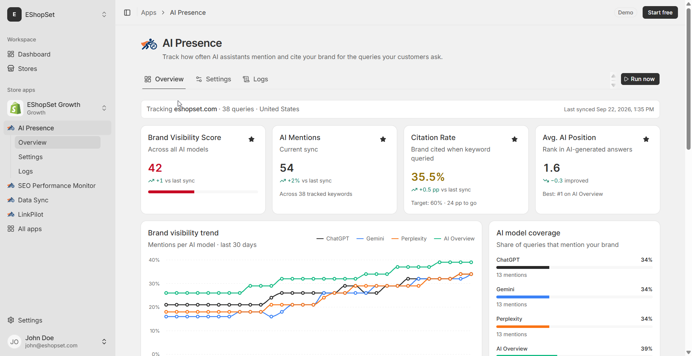

# Compare mentions across AI models

> **Primary keyword:** compare AI model brand mentions  
> **Related:** AI Overviews, ChatGPT citations

*EShopSet AI Presence Overview — same product UI shown on [eshopset.com](https://eshopset.com).*

Shoppers increasingly ask AI assistants what to buy. **compare AI model brand mentions** helps you measure whether ChatGPT, Gemini, Perplexity, and Google AI Overviews cite your brand. Use [AI Presence](https://eshopset.com/apps/ai-presence/) to compare mentions across AI models without bolting on a separate AEO suite.

_Compare how ChatGPT, Gemini, Perplexity, and Google AI Overviews mention your Shopify brand—so you fix the models and prompts that lag._

## Outcomes

- Side-by-side model mention differences
- Prioritize content formats each surface favors
- Avoid one-model bias in executive reporting

## Why model comparison is pillar content

Shoppers don’t use one assistant. If leadership only hears “AI mentions are up,” you may be winning on one model while losing discovery on another. Comparing models turns a vague AI KPI into a channel mix—similar to organic vs paid.

## How it works in EShopSet

AI Presence breaks mentions and citations out by ChatGPT, Gemini, Perplexity, and Google AI Overviews for each tracked query. Use the spread to assign content experiments (e.g., FAQ schema and crisp facts often help Overviews; narrative guides may lift chat models).

## Example: electronics accessory brand

Mentions: ChatGPT 18/50 keywords, Gemini 14/50, Perplexity 9/50, AI Overviews 6/50. The team noticed Overviews favored spec tables and retailer roundups. They added structured spec blocks to top 15 PDPs and a comparison chart; Overviews mentions moved 6 → 15 keywords over a month while ChatGPT stayed roughly flat—proof the gap was format, not brand awareness alone.

## Playbook

1. Export or note mention counts by model.
2. Flag models ≥30% below your best model.
3. Hypothesize format gaps (tables, citations, freshness).
4. Ship one format experiment per lagging model.
5. Re-measure after 10–14 daily syncs.

## What to measure

- Mention count by model
- Model gap (best − worst) week over week
- Queries where only 1 of 4 models mentions you

## Proof points

- **4 models** — Compared in Overview
- **Per keyword** — Model breakdown
- **Weekly** — Exec-ready delta

## Why this belongs in the EShopSet bundle

Instead of stacking a separate AI Presence competitor, SEO suite, AI-visibility tracker, sheet importer, linker, and content tool, EShopSet includes **SEO Performance Monitor**, **AI Presence**, **Data Sync**, **Link Pilot**, and **CopilotPost** on one per-store plan (Starter from **$49/store/mo** at launch). Enable only what this store needs; usage never mixes across stores.

Operate the same apps from **Shopify Sidekick** or connect **EShopSet MCP** in Cursor, Claude, ChatGPT, Gemini, and Copilot.

## Get started

1. [Install EShopSet](https://apps.shopify.com/eshopset) from the Shopify App Store.
2. Enable **AI Presence** and open Overview → Settings → Logs.
3. Follow this playbook, then compare limits on [pricing](https://eshopset.com/pricing/).
4. Optional: try the [live demo](https://demo.eshopset.com) or explore [AI Power](https://eshopset.com/ai-power/).

## Canonical & related

- Website use case: [https://eshopset.com/usecases/ai-visibility/compare-ai-model-mentions/](https://eshopset.com/usecases/ai-visibility/compare-ai-model-mentions/)
- App: [AI Presence](https://eshopset.com/apps/ai-presence/)
- Category: [Shopify AI visibility & AEO use cases](./README.md)
- AI Presence: https://eshopset.com/apps/ai-presence/
- Monitor AI citations: https://eshopset.com/usecases/monitor-ai-citations/
- Close AI mention gaps: https://eshopset.com/usecases/close-ai-mention-gaps/
- Pricing: https://eshopset.com/pricing/

---

[Install Now](https://apps.shopify.com/eshopset) · [Pricing](https://eshopset.com/pricing/) · [Use cases on eshopset.com](https://eshopset.com/usecases/ai-visibility/)
