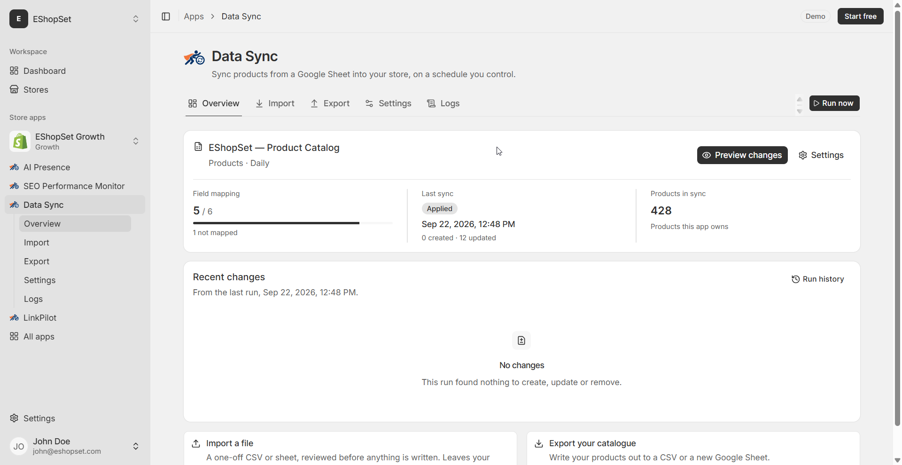

# Preview before apply on catalog changes

> **Primary keyword:** Data Sync preview before apply  
> **Related:** product import safety

*EShopSet Data Sync Overview — same product UI shown on [eshopset.com](https://eshopset.com).*

**Data Sync preview before apply** keeps supplier sheets and Shopify catalogs aligned without CSV upload roulette. [Data Sync](https://eshopset.com/apps/data-sync/) maps columns, previews creates vs updates, then applies—once or on a schedule—inside the same EShopSet plan as SEO and AI Presence.

_Use Data Sync manual preview to review creates, updates, and archives before applying Google Sheet changes to Shopify._

## Outcomes

- See creates / updates / archives before they hit Shopify
- Catch handle collisions and blank required fields early
- Make preview a required step for anyone with sheet edit access

## Why preview is non-negotiable

A single bad filter in Sheets can mark hundreds of rows missing—and sync may interpret that as archives. Preview surfaces those counts while you can still abort.

## How it works in EShopSet

On manual Data Sync runs, preview the diff first. Investigate surprising archive or create spikes. Only apply when counts match the business intent (e.g., “~120 price updates, 0 archives”).

## Example: avoided mass archive

Preview showed 1,100 archives after an ops intern filtered the sheet to “in-stock only” and deleted other rows. They restored the full sheet from version history, re-previewed (0 archives / 180 updates), then applied. That one preview saved a multi-hour Admin recovery.

## Playbook

1. Never apply on the first preview after a large sheet edit.
2. Reconcile archive count with intentional discontinuations.
3. Spot-check 3 create rows and 3 update rows in the preview details.
4. Apply; confirm Logs.
5. For scheduled jobs, re-run manual preview after structural sheet changes.

## What to measure

- Preview-to-apply abort rate (healthy teams abort sometimes)
- Unexpected archive incidents per quarter (target: near zero)

## Proof points

- **3 buckets** — Create · Update · Archive
- **Manual runs** — Preview available
- **<5 min** — Typical review for mid catalogs

## Why this belongs in the EShopSet bundle

Instead of stacking a separate Data Sync competitor, SEO suite, AI-visibility tracker, sheet importer, linker, and content tool, EShopSet includes **SEO Performance Monitor**, **AI Presence**, **Data Sync**, **Link Pilot**, and **CopilotPost** on one per-store plan (Starter from **$49/store/mo** at launch). Enable only what this store needs; usage never mixes across stores.

Operate the same apps from **Shopify Sidekick** or connect **EShopSet MCP** in Cursor, Claude, ChatGPT, Gemini, and Copilot.

## Get started

1. [Install EShopSet](https://apps.shopify.com/eshopset) from the Shopify App Store.
2. Enable **Data Sync** and open Overview → Settings → Logs.
3. Follow this playbook, then compare limits on [pricing](https://eshopset.com/pricing/).
4. Optional: try the [live demo](https://demo.eshopset.com) or explore [AI Power](https://eshopset.com/ai-power/).

## Canonical & related

- Website use case: [https://eshopset.com/usecases/catalog-sync/preview-before-apply-catalog/](https://eshopset.com/usecases/catalog-sync/preview-before-apply-catalog/)
- App: [Data Sync](https://eshopset.com/apps/data-sync/)
- Category: [Shopify Google Sheets catalog sync use cases](./README.md)
- Data Sync: https://eshopset.com/apps/data-sync/
- One-time sheet import: https://eshopset.com/usecases/one-time-sheet-import/
- Map sheet columns: https://eshopset.com/usecases/map-sheet-columns-to-shopify/
- Pricing: https://eshopset.com/pricing/

---

[Install Now](https://apps.shopify.com/eshopset) · [Pricing](https://eshopset.com/pricing/) · [Use cases on eshopset.com](https://eshopset.com/usecases/catalog-sync/)
