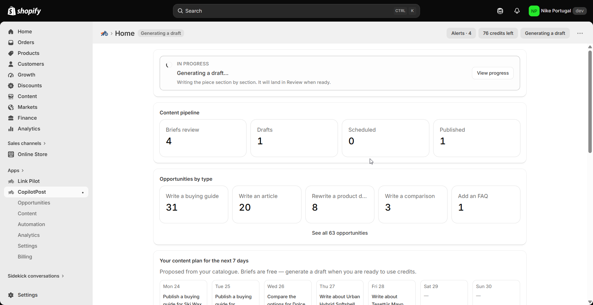
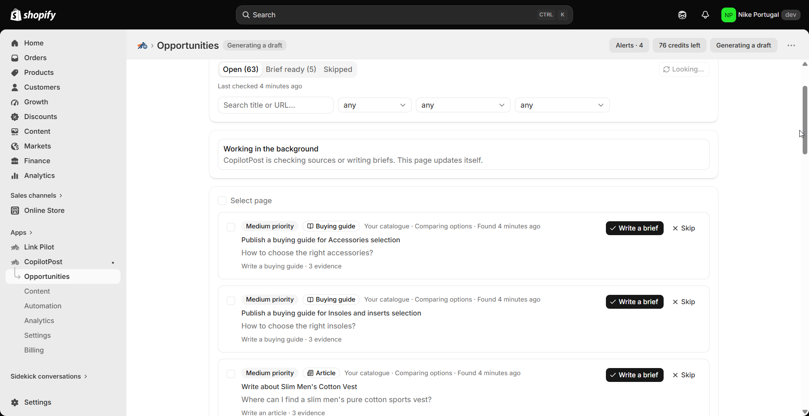
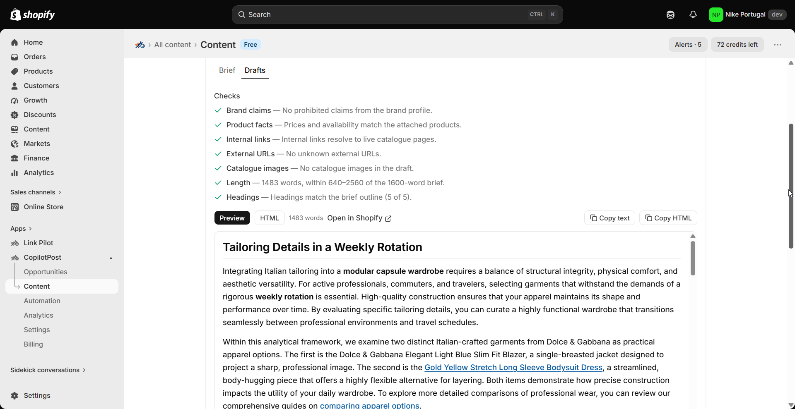

# Shopify content creation use cases

> **Primary keyword:** Shopify AI content creation  
> **Related:** Shopify product description AI, GSC content opportunities Shopify, Shopify buying guide, Shopify article publish approval

Turn catalogue gaps and demand signals into briefs, AI drafts, and approved Shopify blog or product content.

These pages rewrite the published EShopSet use cases for **Shopify AI content creation** and related search intent. Illustrations match the product UI on [eshopset.com](https://eshopset.com).

## Product illustrations

*CopilotPost evidence-backed opportunities*

*CopilotPost draft with approval*

## Use cases in this cluster

- [Evidence-backed content opportunities](./evidence-backed-content-opportunities.md) — `Shopify content opportunities evidence`
- [Product FAQ and description rewrites](./product-faq-and-description-rewrites.md) — `Shopify product FAQ rewrite`
- [Buying guides and comparisons from your catalogue](./buying-guides-and-comparisons-from-catalogue.md) — `Shopify buying guide from catalogue`
- [GSC-driven SEO content for Shopify](./gsc-driven-seo-content-for-shopify.md) — `GSC content opportunities Shopify`
- [Weekly content plan for Shopify stores](./weekly-content-plan-for-shopify-stores.md) — `Shopify weekly content plan`
- [Blog and article publish with approval](./blog-and-article-publish-with-approval.md) — `Shopify article publish approval CopilotPost`
- [Refresh underperforming pages](./refresh-underperforming-pages.md) — `refresh underperforming Shopify content`

## App

- [CopilotPost](https://eshopset.com/apps/copilotpost/)
- [Install EShopSet](https://apps.shopify.com/eshopset)
- [Category on website](https://eshopset.com/usecases/content-creation/)
