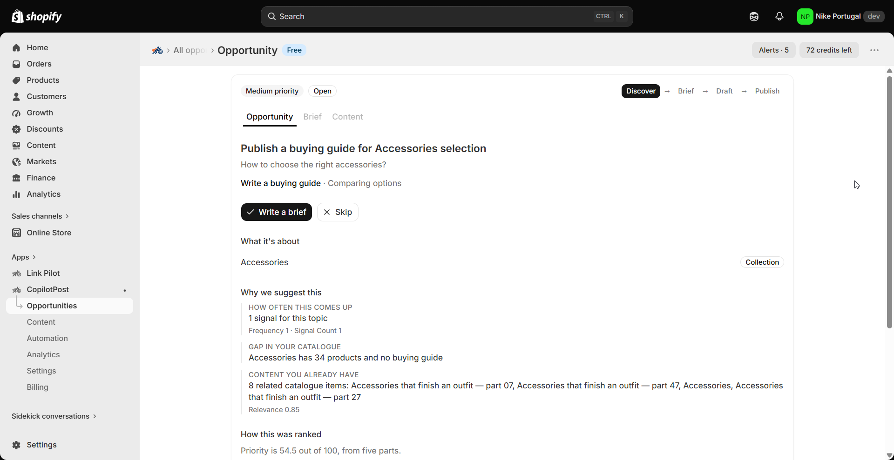

# Buying guides and comparisons from your catalogue

> **Primary keyword:** Shopify buying guide from catalogue  
> **Related:** product comparison article Shopify, CopilotPost buying guide

*CopilotPost opportunity details — same product UI shown on [eshopset.com](https://eshopset.com).*

**Shopify buying guide from catalogue** should start from catalogue and demand evidence—not a blank prompt. [CopilotPost](https://eshopset.com/apps/copilotpost/) ranks opportunities, unlocks free briefs, then credit-priced drafts you publish with approval into Shopify.

_Turn catalogue clusters into Shopify buying guides and comparisons with CopilotPost—4-credit long-form drafts you approve and publish as articles._

## Outcomes

- Commercial and comparison intent matched to ≥3 products when available
- 4-credit drafts for buying guides and comparisons
- Publish as Shopify articles with preview

## Why guides convert research traffic

Shoppers comparing options need curated paths into your SKUs. Guides and comparisons turn catalogue depth into ranking and assist content—without inventing products you do not sell.

## How it works in CopilotPost

Opportunities route to **Write a buying guide** or **Write a comparison** when catalogue matches support it. Accept → brief → draft (4 credits) → review sections → publish article.Guides and comparisons draft as sectioned long-form (4 credits).

## Example: trail shoe comparison

A footwear store has three trail models without a comparison page. CopilotPost proposes a comparison with product cards. The merchant drafts once (4 credits), edits tone, and publishes.

## Playbook

1. Filter Opportunities for guide/comparison actions.
2. Confirm product matches in evidence.
3. Accept and review the free brief.
4. Generate draft; edit claims against Brand rules.
5. Preview and publish within weekly cap.

## What to measure

- Organic sessions to new guides
- Assisted product views from guide links
- Credits spent per published guide

## Proof points

- **4 credits** — Guide / comparison
- **Catalogue** — Grounded in live SKUs
- **Article** — Shopify publish target

## Why this belongs in the EShopSet bundle

Instead of stacking a separate CopilotPost competitor, SEO suite, AI-visibility tracker, sheet importer, linker, and content tool, EShopSet includes **SEO Performance Monitor**, **AI Presence**, **Data Sync**, **Link Pilot**, and **CopilotPost** on one per-store plan (Starter from **$49/store/mo** at launch). Enable only what this store needs; usage never mixes across stores.

Operate the same apps from **Shopify Sidekick** or connect **EShopSet MCP** in Cursor, Claude, ChatGPT, Gemini, and Copilot.

## Get started

1. [Install EShopSet](https://apps.shopify.com/eshopset) from the Shopify App Store.
2. Enable **CopilotPost** and open Overview → Settings → Logs.
3. Follow this playbook, then compare limits on [pricing](https://eshopset.com/pricing/).
4. Optional: try the [live demo](https://demo.eshopset.com) or explore [AI Power](https://eshopset.com/ai-power/).

## Canonical & related

- Website use case: [https://eshopset.com/usecases/content-creation/buying-guides-and-comparisons-from-catalogue/](https://eshopset.com/usecases/content-creation/buying-guides-and-comparisons-from-catalogue/)
- App: [CopilotPost](https://eshopset.com/apps/copilotpost/)
- Category: [Shopify content creation use cases](./README.md)
- CopilotPost: https://eshopset.com/apps/copilotpost/
- Briefs and drafts: https://eshopset.com/help/copilotpost-help/create-briefs-and-generate-drafts/
- Pricing: https://eshopset.com/pricing/

---

[Install Now](https://apps.shopify.com/eshopset) · [Pricing](https://eshopset.com/pricing/) · [Use cases on eshopset.com](https://eshopset.com/usecases/content-creation/)
