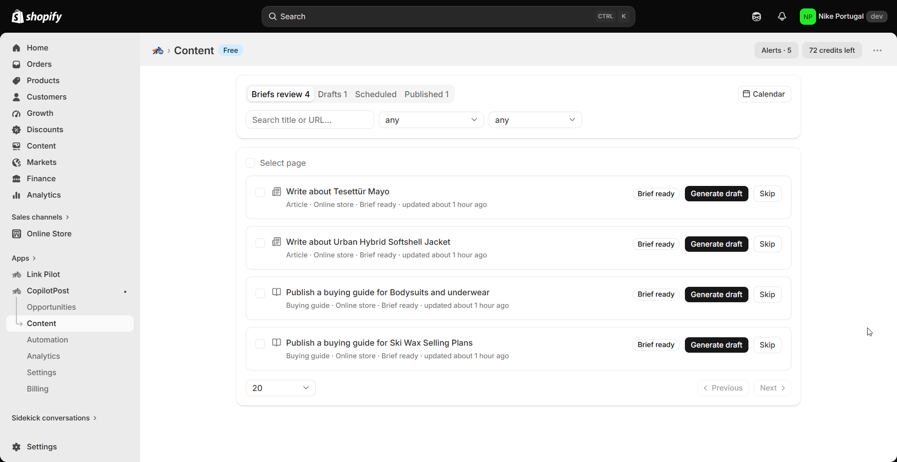

# Refresh underperforming pages

> **Primary keyword:** refresh underperforming Shopify content  
> **Related:** content refresh detection, CopilotPost Growth, update article opportunity

*Refresh content in CopilotPost — same product UI shown on [eshopset.com](https://eshopset.com).*

**refresh underperforming Shopify content** should start from catalogue and demand evidence—not a blank prompt. [CopilotPost](https://eshopset.com/apps/copilotpost/) ranks opportunities, unlocks free briefs, then credit-priced drafts you publish with approval into Shopify.

_On Growth+, CopilotPost detects traffic decay on published pages and suggests refresh opportunities so you can update articles with approval._

## Outcomes

- Growth+ performance sync and refresh detection
- Needs-update opportunities from click drop signals
- Same approval and weekly cap rules as new content

## Why refresh beats only publishing new

Published guides decay as competitors update and seasonality shifts. Refreshing proven URLs protects equity better than endless new posts alone.

## How it works in CopilotPost

Growth+ runs performance sync on CopilotPost-published items and opens refresh opportunities when clicks drop. Accept → brief → draft (often update article) → publish. Home can show a performance rollup.Decay signals open update opportunities you can accept.

## Example: guide CTR drop

A winter guide published in November loses clicks in March. Refresh detection flags it. The merchant updates sections for spring SKUs and republishes under the weekly cap.

## Playbook

1. Confirm Growth (or Pro) plan limits include refresh detection.
2. Review Analytics / Home performance widgets.
3. Open refresh opportunities; accept priority URLs.
4. Draft updates; preview; publish.
5. Watch Analytics after 14 days.

## What to measure

- Recovered clicks on refreshed URLs
- Refresh opportunities closed
- Credits per refresh vs new article

## Proof points

- **Growth+** — Refresh detection
- **Update** — Article opportunities
- **Approve** — Still required

## Why this belongs in the EShopSet bundle

Instead of stacking a separate CopilotPost competitor, SEO suite, AI-visibility tracker, sheet importer, linker, and content tool, EShopSet includes **SEO Performance Monitor**, **AI Presence**, **Data Sync**, **Link Pilot**, and **CopilotPost** on one per-store plan (Starter from **$49/store/mo** at launch). Enable only what this store needs; usage never mixes across stores.

Operate the same apps from **Shopify Sidekick** or connect **EShopSet MCP** in Cursor, Claude, ChatGPT, Gemini, and Copilot.

## Get started

1. [Install EShopSet](https://apps.shopify.com/eshopset) from the Shopify App Store.
2. Enable **CopilotPost** and open Overview → Settings → Logs.
3. Follow this playbook, then compare limits on [pricing](https://eshopset.com/pricing/).
4. Optional: try the [live demo](https://demo.eshopset.com) or explore [AI Power](https://eshopset.com/ai-power/).

## Canonical & related

- Website use case: [https://eshopset.com/usecases/content-creation/refresh-underperforming-pages/](https://eshopset.com/usecases/content-creation/refresh-underperforming-pages/)
- App: [CopilotPost](https://eshopset.com/apps/copilotpost/)
- Category: [Shopify content creation use cases](./README.md)
- CopilotPost: https://eshopset.com/apps/copilotpost/
- Analytics and plans: https://eshopset.com/help/copilotpost-help/analytics-credits-and-plans/
- Pricing: https://eshopset.com/pricing/

---

[Install Now](https://apps.shopify.com/eshopset) · [Pricing](https://eshopset.com/pricing/) · [Use cases on eshopset.com](https://eshopset.com/usecases/content-creation/)
