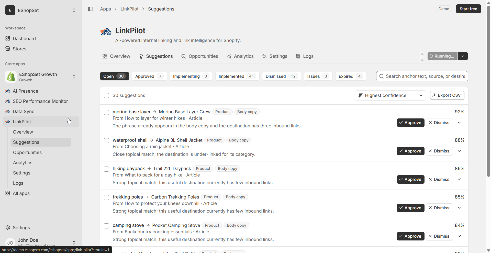
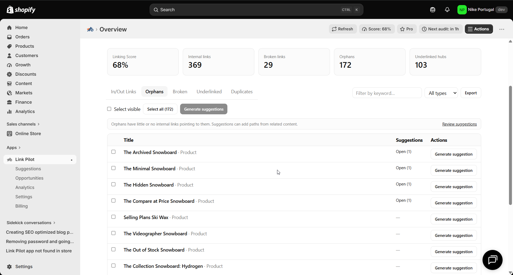
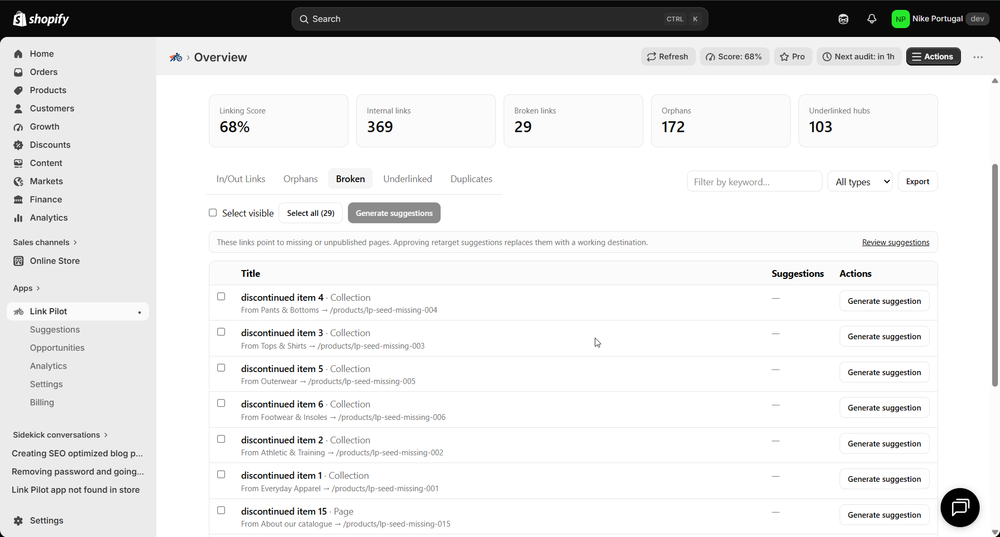

# Shopify internal linking use cases

> **Primary keyword:** Shopify internal linking  
> **Related:** Shopify orphan pages, Shopify broken internal links, blog to product internal linking, underlinked Shopify product pages

Find orphan and underlinked Shopify pages, suggest contextual links, and apply with coverage controls.

These pages rewrite the published EShopSet use cases for **Shopify internal linking** and related search intent. Illustrations match the product UI on [eshopset.com](https://eshopset.com).

## Product illustrations

*Link Pilot orphan pages Overview*

*Link Pilot underlinked hubs Overview*

*Link Pilot broken links Overview*

## Use cases in this cluster

- [Fix orphan Shopify pages with internal links](./fix-orphan-shopify-pages.md) — `Shopify orphan pages internal links`
- [Repair broken internal links after catalog changes](./repair-broken-internal-links.md) — `Shopify broken internal links`
- [Strengthen underlinked product and collection hubs](./strengthen-underlinked-product-hubs.md) — `underlinked Shopify product pages`
- [Add contextual blog-to-product internal links](./add-contextual-blog-to-product-links.md) — `Shopify blog to product internal linking`
- [Target Search Console queries with internal links](./target-gsc-queries-with-internal-links.md) — `GSC queries internal linking Shopify`
- [Measure internal link CTR and attributed checkouts](./measure-internal-link-ctr.md) — `Shopify internal link analytics CTR`

## App

- [Link Pilot](https://eshopset.com/apps/link-pilot/)
- [Install EShopSet](https://apps.shopify.com/eshopset)
- [Category on website](https://eshopset.com/usecases/internal-linking/)
