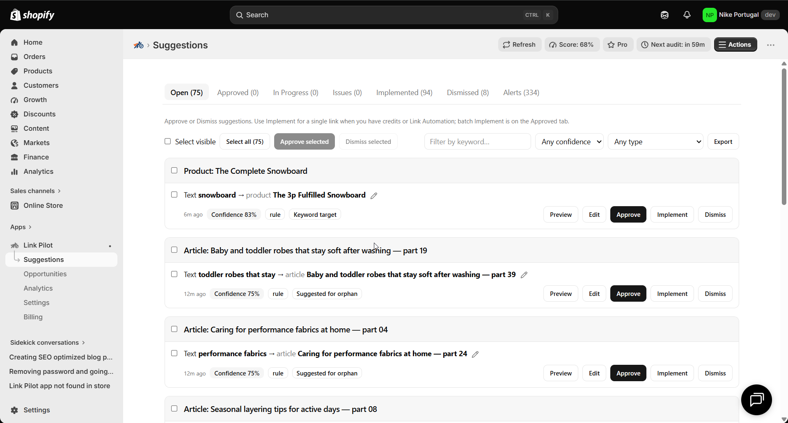

# Add contextual blog-to-product internal links

> **Primary keyword:** Shopify blog to product internal linking  
> **Related:** contextual product links, semantic internal linking Shopify, missing commercial link

*Link Pilot link suggestions — same product UI shown on [eshopset.com](https://eshopset.com).*

**Shopify blog to product internal linking** strengthens crawl paths between blogs, products, and collections. [Link Pilot](https://eshopset.com/apps/link-pilot/) surfaces orphans, underlinked hubs, and broken links, then suggests contextual anchors you can apply or export—bundled with your other EShopSet apps.

_Turn Shopify blog and page copy into contextual product and collection links with Link Pilot semantic and commercial suggestions._

## Outcomes

- AI embeddings rank same-locale cosine neighbors (35% of Confidence)
- Commercial-value weight boosts blog/page → product/collection paths
- Hover Confidence for Semantic, Context, and Commercial; edit anchors before apply

## Why contextual blog links convert and rank

Blogs attract informational queries; products convert. Without in-copy links, readers bounce or search again. Contextual anchors also help crawlers associate topics with commercial entities—useful for classic SEO and for AI systems that cite or summarize your guides.

## How it works in Link Pilot

Suggestion generation combines **missing commercial link** rules with **semantic** matches from AI embeddings (top neighbors by cosine, same locale). Confidence is a weighted score—**35% semantic relevance**, plus context overlap and a commercial-value boost when blogs/pages point at products or collections. AI writes the Why and a safe anchor that **must already appear** in the source; it does not pick the percentage. Hover **Confidence** for Semantic, Context, Title mention, Commercial, and Link scarcity. You still approve, edit, or dismiss.

## Example: “winter running” guide → Winter collection

A running store’s long guide mentions winter conditions but never links the Winter collection. A semantic match proposes wrapping “winter trail shoes” to the collection URL at **88% Confidence**. The tooltip shows high cosine plus commercial-path context (blog → collection).

The merchant edits the anchor to the exact phrase in the paragraph, approves, and applies one credit. The guide becomes a durable entry path into the seasonal hub.

## Playbook

1. Publish or refresh a blog/page with natural product language.
2. Run suggest (or wait for Automation).
3. In Suggestions, filter semantic / missing commercial types sourced from articles/pages.
4. Open details; verify destination and that the anchor exists verbatim.
5. Approve a small set per article (respect Settings max links).
6. Apply with credits; spot-check the live article HTML.

## What to measure

- Blog → product/collection click-through (Analytics with Link Automation)
- Assisted conversions from applied links
- Number of money-page links added per content piece

## Proof points

- **Substring** — Anchors must exist in copy
- **AI + rules** — Suggestion engines
- **Sidekick** — Shopify agent tools

## Why this belongs in the EShopSet bundle

Instead of stacking a separate Link Pilot competitor, SEO suite, AI-visibility tracker, sheet importer, linker, and content tool, EShopSet includes **SEO Performance Monitor**, **AI Presence**, **Data Sync**, **Link Pilot**, and **CopilotPost** on one per-store plan (Starter from **$49/store/mo** at launch). Enable only what this store needs; usage never mixes across stores.

Operate the same apps from **Shopify Sidekick** or connect **EShopSet MCP** in Cursor, Claude, ChatGPT, Gemini, and Copilot.

## Get started

1. [Install EShopSet](https://apps.shopify.com/eshopset) from the Shopify App Store.
2. Enable **Link Pilot** and open Overview → Settings → Logs.
3. Follow this playbook, then compare limits on [pricing](https://eshopset.com/pricing/).
4. Optional: try the [live demo](https://demo.eshopset.com) or explore [AI Power](https://eshopset.com/ai-power/).

## Canonical & related

- Website use case: [https://eshopset.com/usecases/internal-linking/add-contextual-blog-to-product-links/](https://eshopset.com/usecases/internal-linking/add-contextual-blog-to-product-links/)
- App: [Link Pilot](https://eshopset.com/apps/link-pilot/)
- Category: [Shopify internal linking use cases](./README.md)
- How suggestion confidence is scored: https://eshopset.com/help/linkpilot/how-suggestion-confidence-is-scored/
- How AI and rules generate suggestions: https://eshopset.com/help/linkpilot/how-ai-and-rules-generate-suggestions/
- Link Pilot: https://eshopset.com/apps/link-pilot/

---

[Install Now](https://apps.shopify.com/eshopset) · [Pricing](https://eshopset.com/pricing/) · [Use cases on eshopset.com](https://eshopset.com/usecases/internal-linking/)
