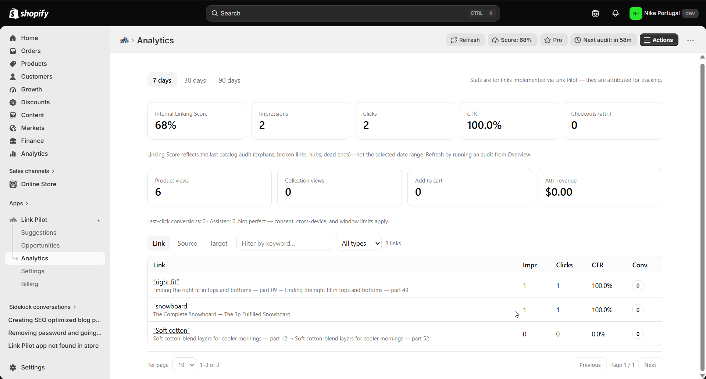

# Measure internal link CTR and attributed checkouts

> **Primary keyword:** Shopify internal link analytics CTR  
> **Related:** internal link conversion tracking, Link Pilot Analytics, attributed checkouts

*Link Pilot analytics — same product UI shown on [eshopset.com](https://eshopset.com).*

**Shopify internal link analytics CTR** strengthens crawl paths between blogs, products, and collections. [Link Pilot](https://eshopset.com/apps/link-pilot/) surfaces orphans, underlinked hubs, and broken links, then suggests contextual anchors you can apply or export—bundled with your other EShopSet apps.

_Use Link Pilot Analytics with Link Automation to track impressions, CTR, and attributed funnel events for applied Shopify internal links._

## Outcomes

- Do not mix Overview Score (graph health), suggestion Confidence, and Analytics CTR
- Track only links applied through Link Pilot (Link Automation + pixel)
- Use Confidence to choose what to apply; use CTR to learn which anchors worked

## Why measure applied links

Without measurement, internal linking becomes a one-off cleanup. Keep three metrics separate: **Overview Score** is store-wide graph health (orphans, broken, underlinked, dead ends). **Confidence** is how strong a suggestion was before you applied it. **Analytics CTR** is how shoppers click applied links. CTR and attributed product views / ATC / checkouts tell you which contextual anchors deserve more of the same treatment.

## How it works in Link Pilot

Suggestions still come from **rules plus AI embeddings**; merchants review Confidence and Why before apply. Link Automation then enables Analytics and the storefront web pixel so applied links can be attributed. Open **Analytics** for rollups; drill into a link for detail. Digests can email weekly stats when Notifications are on. A high-Confidence suggestion can still earn low CTR if the placement is weak—and a healthy Overview Score does not imply shoppers click the new anchors.

## Example: two blogs, one winner

A merchant’s Overview Score is **71%** after an orphan batch. They apply 20 blog→product links, most at **85%+** Confidence. After 30 days, Analytics shows three anchors above **4% CTR** and two near zero.

They replicate the winning phrasing on similar guides and dismiss low-CTR patterns going forward—improving credit efficiency on Growth (2,500 monthly credits) without treating Score, Confidence, and CTR as the same number.

## Playbook

1. Activate Link Automation and confirm the pixel is installed.
2. Apply a dated batch of links (note the date).
3. Wait for traffic; open **Analytics** on 7- and 30-day ranges.
4. Sort by CTR and attributed checkouts; open weak links for QA (placement, anchor quality).
5. Feed insights back into Suggestions filters and Settings confidence.
6. Enable weekly analytics digest for a lightweight ops ritual.

## What to measure

- CTR by source type (blog vs product vs page)
- Attributed ATC and checkouts per applied link
- Credit ROI: conversions influenced per 100 implements

## Proof points

- **7/30/90d** — Analytics ranges
- **Pixel** — Storefront tracking
- **$19+** — Automation for Analytics

## Why this belongs in the EShopSet bundle

Instead of stacking a separate Link Pilot competitor, SEO suite, AI-visibility tracker, sheet importer, linker, and content tool, EShopSet includes **SEO Performance Monitor**, **AI Presence**, **Data Sync**, **Link Pilot**, and **CopilotPost** on one per-store plan (Starter from **$49/store/mo** at launch). Enable only what this store needs; usage never mixes across stores.

Operate the same apps from **Shopify Sidekick** or connect **EShopSet MCP** in Cursor, Claude, ChatGPT, Gemini, and Copilot.

## Get started

1. [Install EShopSet](https://apps.shopify.com/eshopset) from the Shopify App Store.
2. Enable **Link Pilot** and open Overview → Settings → Logs.
3. Follow this playbook, then compare limits on [pricing](https://eshopset.com/pricing/).
4. Optional: try the [live demo](https://demo.eshopset.com) or explore [AI Power](https://eshopset.com/ai-power/).

## Canonical & related

- Website use case: [https://eshopset.com/usecases/internal-linking/measure-internal-link-ctr/](https://eshopset.com/usecases/internal-linking/measure-internal-link-ctr/)
- App: [Link Pilot](https://eshopset.com/apps/link-pilot/)
- Category: [Shopify internal linking use cases](./README.md)
- How the Overview linking score works: https://eshopset.com/help/linkpilot/how-overview-linking-score-works/
- How suggestion confidence is scored: https://eshopset.com/help/linkpilot/how-suggestion-confidence-is-scored/
- Analytics and billing: https://eshopset.com/help/linkpilot/analytics-and-billing/

---

[Install Now](https://apps.shopify.com/eshopset) · [Pricing](https://eshopset.com/pricing/) · [Use cases on eshopset.com](https://eshopset.com/usecases/internal-linking/)
