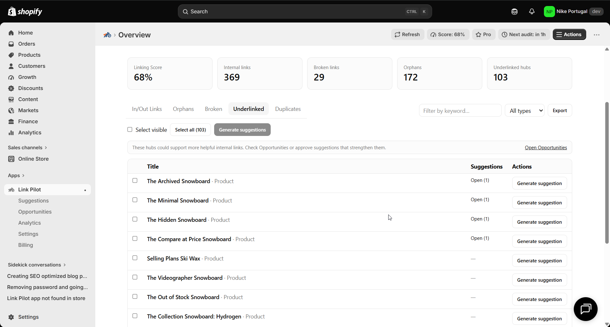

# Strengthen underlinked product and collection hubs

> **Primary keyword:** underlinked Shopify product pages  
> **Related:** collection hub internal links, strengthen product SEO links, Link Pilot underlinked

*Underlinked hubs in Link Pilot — same product UI shown on [eshopset.com](https://eshopset.com).*

**underlinked Shopify product pages** strengthens crawl paths between blogs, products, and collections. [Link Pilot](https://eshopset.com/apps/link-pilot/) surfaces orphans, underlinked hubs, and broken links, then suggests contextual anchors you can apply or export—bundled with your other EShopSet apps.

_Use Link Pilot underlinked hub suggestions to add inbound internal links to important Shopify products and collections._

## Outcomes

- Overview Score deducts 20% when products/collections sit below peer-median inbound
- Underlinked-hub rules plus 10% Confidence scarcity weight surface thin money pages
- Cap density with Settings limits so pages stay readable

## Why hubs need inbound links

Collection and hero product pages concentrate commercial intent. If only thin category copy and theme grids point to them, supporting blogs and secondary products never reinforce the hub. Underlinking also leaves AI answer engines with fewer clear entity paths from educational content to the buy page.

## How it works in Link Pilot

**Overview → Underlinked** highlights products and collections below the peer median inbound (at least one expected)—that bucket is **20%** of Overview Score. Generators emit **underlinked hub** and **missing commercial link** suggestions alongside AI embeddings. Confidence adds a **10% link-scarcity** weight for destinations that still need inbound, plus commercial-value weight (product/collection over article/page). You still review Why and edit anchors. Settings → Limits caps max links per content item and inbound per destination so you do not overstuff.

## Example: bestseller PDP with two inbound links

A skincare bestseller has strong ads traffic but only two inbound body links from the brand story page. Overview marks it underlinked and Score shows the hub deduction. Link Pilot suggests six blog sources mentioning the ingredient; four sit at **81–89% Confidence** (scarcity + commercial value + cosine).

The merchant approves those four (Growth Automation credits), keeping max links per article at five. After re-audit, inbound on the PDP clears the peer median and organic landing share rises over the next month alongside content refreshes.

## Playbook

1. Open **Overview → Underlinked**; focus on collections and top revenue PDPs.
2. Confirm Settings limits (e.g. max 5 links per item).
3. Generate suggestions; filter underlinked / commercial types.
4. Approve only natural anchors that already appear in source copy.
5. Apply a measured batch; re-check inbound counts on the hub.
6. Schedule a monthly re-review when publishing new blogs.

## What to measure

- Inbound body links to each hub
- Organic sessions to hub URLs
- Suggestion acceptance rate for underlinked types

## Proof points

- **Default 5** — Max links per content item
- **$19–$59** — Link Automation / month
- **500–5,000** — Monthly implement credits

## Why this belongs in the EShopSet bundle

Instead of stacking a separate Link Pilot competitor, SEO suite, AI-visibility tracker, sheet importer, linker, and content tool, EShopSet includes **SEO Performance Monitor**, **AI Presence**, **Data Sync**, **Link Pilot**, and **CopilotPost** on one per-store plan (Starter from **$49/store/mo** at launch). Enable only what this store needs; usage never mixes across stores.

Operate the same apps from **Shopify Sidekick** or connect **EShopSet MCP** in Cursor, Claude, ChatGPT, Gemini, and Copilot.

## Get started

1. [Install EShopSet](https://apps.shopify.com/eshopset) from the Shopify App Store.
2. Enable **Link Pilot** and open Overview → Settings → Logs.
3. Follow this playbook, then compare limits on [pricing](https://eshopset.com/pricing/).
4. Optional: try the [live demo](https://demo.eshopset.com) or explore [AI Power](https://eshopset.com/ai-power/).

## Canonical & related

- Website use case: [https://eshopset.com/usecases/internal-linking/strengthen-underlinked-product-hubs/](https://eshopset.com/usecases/internal-linking/strengthen-underlinked-product-hubs/)
- App: [Link Pilot](https://eshopset.com/apps/link-pilot/)
- Category: [Shopify internal linking use cases](./README.md)
- How suggestion confidence is scored: https://eshopset.com/help/linkpilot/how-suggestion-confidence-is-scored/
- How the Overview linking score works: https://eshopset.com/help/linkpilot/how-overview-linking-score-works/
- Link Pilot: https://eshopset.com/apps/link-pilot/

---

[Install Now](https://apps.shopify.com/eshopset) · [Pricing](https://eshopset.com/pricing/) · [Use cases on eshopset.com](https://eshopset.com/usecases/internal-linking/)
