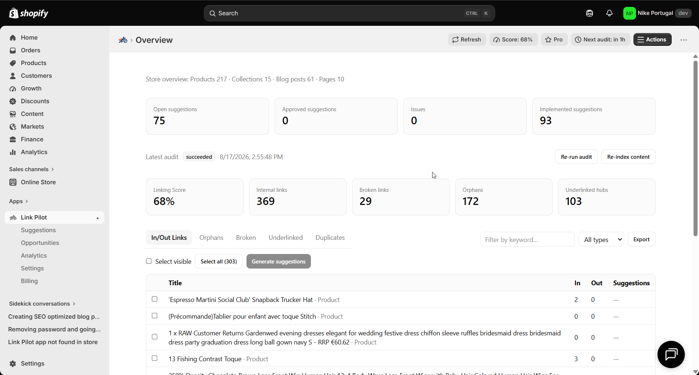

# Target Search Console queries with internal links

> **Primary keyword:** GSC queries internal linking Shopify  
> **Related:** Search Console internal links, keyword target suggestions, Link Pilot Opportunities

*In/out links coverage in Link Pilot — same product UI shown on [eshopset.com](https://eshopset.com).*

**GSC queries internal linking Shopify** strengthens crawl paths between blogs, products, and collections. [Link Pilot](https://eshopset.com/apps/link-pilot/) surfaces orphans, underlinked hubs, and broken links, then suggests contextual anchors you can apply or export—bundled with your other EShopSet apps.

_Import Google Search Console queries into Link Pilot Opportunities and generate keyword-target internal links to the right Shopify destinations._

## Outcomes

- Keyword-target suggestions are still scored with the same Confidence weights
- AI can suggest destinations and safe anchors from matching source copy
- Requires Link Automation for Opportunities (GSC CSV or manual keywords)

## Why GSC-led linking beats guesswork

Search Console shows queries you already almost win. Internal links that reinforce those destinations with natural anchors help consolidate relevance—especially when blogs mention the query language but never point to the ranking URL. This workflow is also easy for AI agents to follow: query → destination → source → apply.

## How it works in Link Pilot

**Opportunities** (Link Automation) accepts manual keywords or a GSC Performance Queries CSV. Map each query to a destination (AI can suggest or validate a URL where enabled), choose source types, and generate **keyword target** suggestions. Those rows still get a deterministic **Confidence** score—semantic cosine, context, commercial value, scarcity, title mention—then an AI Why and a substring-safe anchor. Approve in Suggestions and apply with monthly credits. Keyword targeting does not change Overview Score until applied links change the graph.

## Example: queries in positions 8–15

A home-goods brand exports Queries.csv and filters to commercial phrases in positions 8–15. They map “linen duvet cover queen” to the matching product. Generated keyword targets land around **70–82% Confidence** (title mention + commercial value when the phrase already appears in blogs).

They approve five blog sources, apply, then watch GSC average position and Link Pilot Analytics CTR for those new edges over 30 days—separate from Overview Score.

## Playbook

1. Subscribe to Link Automation (Starter+ unlocks Opportunities).
2. Export GSC Performance → Queries CSV (or list priority keywords).
3. In **Opportunities**, import CSV or add keywords; set destinations.
4. Generate suggestions; open **Suggestions** filtered to keyword targets.
5. Edit anchors for natural language; approve a controlled batch.
6. Apply with monthly credits; log the query set for a 30-day review.

## What to measure

- GSC position and CTR for targeted queries
- Internal link clicks to the mapped destination (Analytics)
- Coverage: % of priority queries with ≥1 applied keyword-target link

## Proof points

- **Starter+** — Opportunities entitlement
- **500+** — Monthly credits from $19
- **CSV** — GSC Queries import

## Why this belongs in the EShopSet bundle

Instead of stacking a separate Link Pilot competitor, SEO suite, AI-visibility tracker, sheet importer, linker, and content tool, EShopSet includes **SEO Performance Monitor**, **AI Presence**, **Data Sync**, **Link Pilot**, and **CopilotPost** on one per-store plan (Starter from **$49/store/mo** at launch). Enable only what this store needs; usage never mixes across stores.

Operate the same apps from **Shopify Sidekick** or connect **EShopSet MCP** in Cursor, Claude, ChatGPT, Gemini, and Copilot.

## Get started

1. [Install EShopSet](https://apps.shopify.com/eshopset) from the Shopify App Store.
2. Enable **Link Pilot** and open Overview → Settings → Logs.
3. Follow this playbook, then compare limits on [pricing](https://eshopset.com/pricing/).
4. Optional: try the [live demo](https://demo.eshopset.com) or explore [AI Power](https://eshopset.com/ai-power/).

## Canonical & related

- Website use case: [https://eshopset.com/usecases/internal-linking/target-gsc-queries-with-internal-links/](https://eshopset.com/usecases/internal-linking/target-gsc-queries-with-internal-links/)
- App: [Link Pilot](https://eshopset.com/apps/link-pilot/)
- Category: [Shopify internal linking use cases](./README.md)
- How suggestion confidence is scored: https://eshopset.com/help/linkpilot/how-suggestion-confidence-is-scored/
- Map Search Console opportunities: https://eshopset.com/help/linkpilot/map-search-console-opportunities/
- Link Pilot: https://eshopset.com/apps/link-pilot/

---

[Install Now](https://apps.shopify.com/eshopset) · [Pricing](https://eshopset.com/pricing/) · [Use cases on eshopset.com](https://eshopset.com/usecases/internal-linking/)
