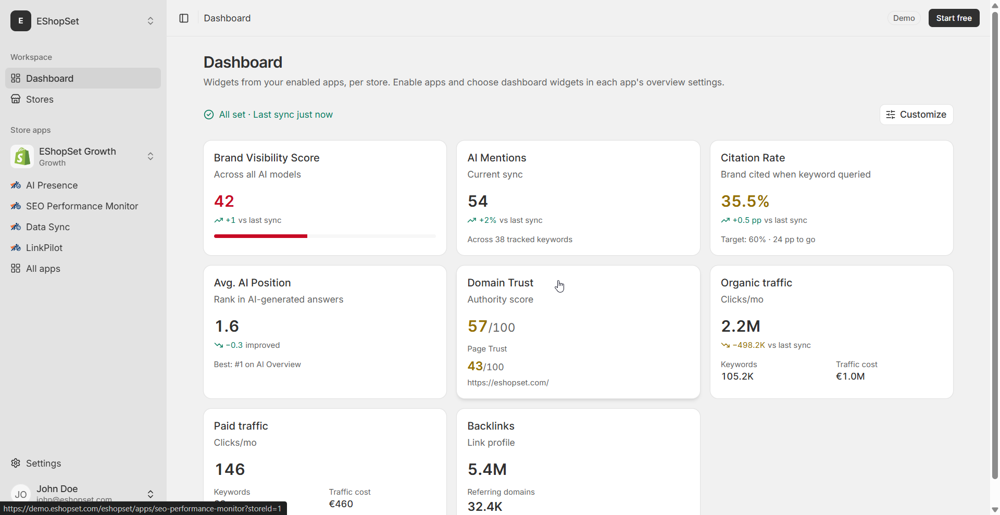

# Morning ops ritual across the portfolio

> **Primary keyword:** multi-store Shopify morning ops  
> **Related:** Overview, Logs, portfolio checklist

*EShopSet multi-store per-store apps — same product UI shown on [eshopset.com](https://eshopset.com).*

**multi-store Shopify morning ops** means each Shopify store keeps its own plan, app enables, and usage limits—not a shared multi-store control center. This use case shows how in-house teams, agencies, and freelancers run morning ops ritual across the portfolio store by store with EShopSet.

_In-house teams: run a morning Overview/Logs check across every Shopify store’s SEO Performance Monitor, AI Presence, and Data Sync—each store on its own plan._

## Outcomes

- Same 10–15 minute ritual, repeated per store
- Green / yellow / red status across SEO, AI Presence, and Data Sync
- Escalate per store—not a shared multi-store control center

## Why a portfolio ritual

Issues compound overnight on whichever store is ignored. A fixed order (largest GMV first, or alphabetical) keeps coverage honest without building custom tooling.

## How it works in EShopSet

Keep a checklist of store URLs. For each store: open SEO Overview → AI Presence Overview → Data Sync Overview; confirm last sync; flag anomalies; open Logs only for failures. Record status in a standup note.

## Example: five-store morning

Ops spent ~40 minutes across five Growth stores. Four green; one Data Sync red (barcode mismatch). They fixed the sheet and re-applied before 9am—other stores untouched.

## Playbook

1. Maintain ordered store list + owners.
2. Per store: three Overviews; note sync time.
3. Yellow/red → Logs; assign owner.
4. Standup: one line per store.
5. Weekly: review which stores are chronically yellow.

## What to measure

- Minutes per store for the ritual
- % stores green by 10am
- Open red items aged >24h

## Proof points

- **3 apps** — Per store Overviews
- **10–15 min** — Per store target
- **Per store** — Plan &amp; billing

## Why this belongs in the EShopSet bundle

Instead of stacking a separate EShopSet bundle competitor, SEO suite, AI-visibility tracker, sheet importer, linker, and content tool, EShopSet includes **SEO Performance Monitor**, **AI Presence**, **Data Sync**, **Link Pilot**, and **CopilotPost** on one per-store plan (Starter from **$49/store/mo** at launch). Enable only what this store needs; usage never mixes across stores.

Operate the same apps from **Shopify Sidekick** or connect **EShopSet MCP** in Cursor, Claude, ChatGPT, Gemini, and Copilot.

## Get started

1. [Install EShopSet](https://apps.shopify.com/eshopset) from the Shopify App Store.
2. Enable **EShopSet bundle** and open Overview → Settings → Logs.
3. Follow this playbook, then compare limits on [pricing](https://eshopset.com/pricing/).
4. Optional: try the [live demo](https://demo.eshopset.com) or explore [AI Power](https://eshopset.com/ai-power/).

## Canonical & related

- Website use case: [https://eshopset.com/usecases/multi-store-management/in-house-multi-store-morning-ops/](https://eshopset.com/usecases/multi-store-management/in-house-multi-store-morning-ops/)
- App: [EShopSet bundle](https://eshopset.com/usecases/multi-store-management/)
- Category: [Multi-store Shopify management use cases](./README.md)
- Morning Shopify ops check: https://eshopset.com/usecases/morning-ops-check/
- Review app logs: https://eshopset.com/usecases/review-app-logs-after-sync/
- Match plan limits: https://eshopset.com/usecases/match-plan-limits-to-store/
- Pricing: https://eshopset.com/pricing/

---

[Install Now](https://apps.shopify.com/eshopset) · [Pricing](https://eshopset.com/pricing/) · [Use cases on eshopset.com](https://eshopset.com/usecases/multi-store-management/)
