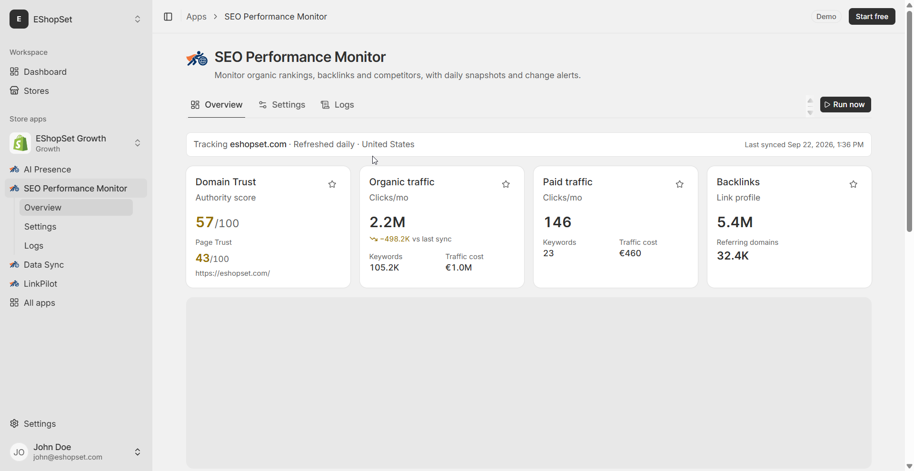

# Check traffic by country

> **Primary keyword:** Shopify traffic by country  
> **Related:** organic traffic, paid traffic

*EShopSet SEO Performance Monitor Overview — same product UI shown on [eshopset.com](https://eshopset.com).*

**Shopify traffic by country** is how Shopify merchants catch ranking and traffic shifts before they hit revenue. This playbook shows how to check traffic by country with [SEO Performance Monitor](https://eshopset.com/apps/seo-performance-monitor/) inside the EShopSet bundle—so trust scores, organic keywords, and competitors live next to your other store ops apps.

_Toggle organic and paid traffic by country in SEO Performance Monitor to see which Shopify markets move after catalog, content, or ads changes._

## Outcomes

- Separate organic vs paid by country after launches
- Catch market-specific regressions within a few daily syncs
- Align SEO work with Markets / localization bets

## Why country views matter

A US-heavy catalog change can look “flat” globally while DE or UK organic collapses—or while paid props up a weak organic market. Country toggles make those stories visible before finance asks why CAC spiked in one region.

## How it works in EShopSet

In SEO Performance Monitor Overview, toggle organic and paid traffic by country. Compare before/after a Markets launch, translation push, or paid campaign. Pair with keyword reviews for locale-specific queries when you expand the tracked set.

## Example: EU expansion

A brand opened Shopify Markets for FR and DE. Two weeks later, US organic was flat, but FR organic share rose from 4% → 9% of sessions while DE paid climbed without organic follow-through. The team prioritized DE collection translations and hreflang checks instead of more US blog posts—saving roughly a sprint of misallocated content time.

## Playbook

1. Snapshot country mix the day before a market or campaign change.
2. After 3–7 daily syncs, compare organic vs paid by country.
3. Flag any market with ≥5 percentage-point mix shift.
4. For organic drops: check localized URLs and rankings for that market’s keywords.
5. For paid-only growth: decide whether SEO should catch up or stay paid-led.

## What to measure

- Organic session share by top 5 countries
- Paid vs organic ratio per market
- Keyword movement on market-specific terms

## Proof points

- **Organic + paid** — Traffic modes
- **≥5 pt** — Mix shift to investigate
- **Daily** — Sync freshness

## Why this belongs in the EShopSet bundle

Instead of stacking a separate SEO Performance Monitor competitor, SEO suite, AI-visibility tracker, sheet importer, linker, and content tool, EShopSet includes **SEO Performance Monitor**, **AI Presence**, **Data Sync**, **Link Pilot**, and **CopilotPost** on one per-store plan (Starter from **$49/store/mo** at launch). Enable only what this store needs; usage never mixes across stores.

Operate the same apps from **Shopify Sidekick** or connect **EShopSet MCP** in Cursor, Claude, ChatGPT, Gemini, and Copilot.

## Get started

1. [Install EShopSet](https://apps.shopify.com/eshopset) from the Shopify App Store.
2. Enable **SEO Performance Monitor** and open Overview → Settings → Logs.
3. Follow this playbook, then compare limits on [pricing](https://eshopset.com/pricing/).
4. Optional: try the [live demo](https://demo.eshopset.com) or explore [AI Power](https://eshopset.com/ai-power/).

## Canonical & related

- Website use case: [https://eshopset.com/usecases/seo-monitoring/country-traffic-performance/](https://eshopset.com/usecases/seo-monitoring/country-traffic-performance/)
- App: [SEO Performance Monitor](https://eshopset.com/apps/seo-performance-monitor/)
- Category: [Shopify SEO monitoring use cases](./README.md)
- SEO Performance Monitor: https://eshopset.com/apps/seo-performance-monitor/
- Track competitor organic share: https://eshopset.com/usecases/track-competitor-organic-share/
- Weekly rankings review: https://eshopset.com/usecases/weekly-rankings-review/
- Pricing: https://eshopset.com/pricing/

---

[Install Now](https://apps.shopify.com/eshopset) · [Pricing](https://eshopset.com/pricing/) · [Use cases on eshopset.com](https://eshopset.com/usecases/seo-monitoring/)
